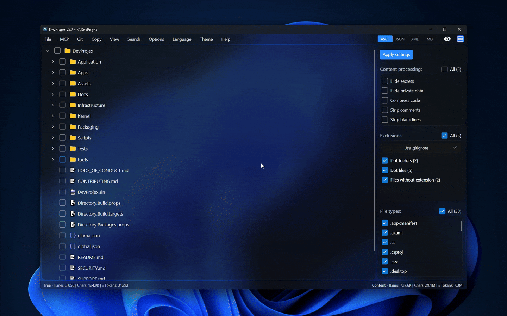
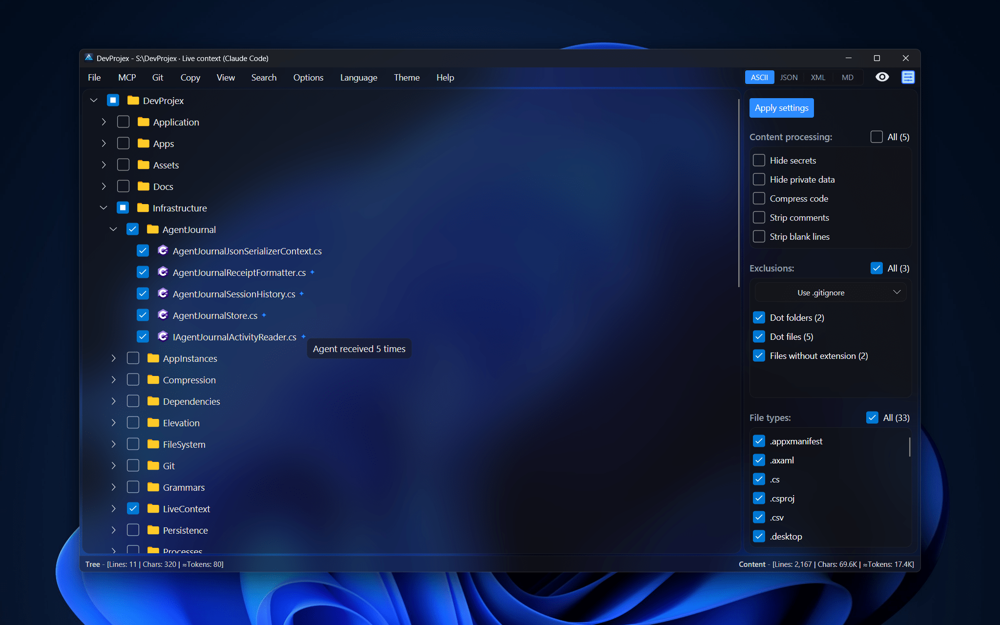
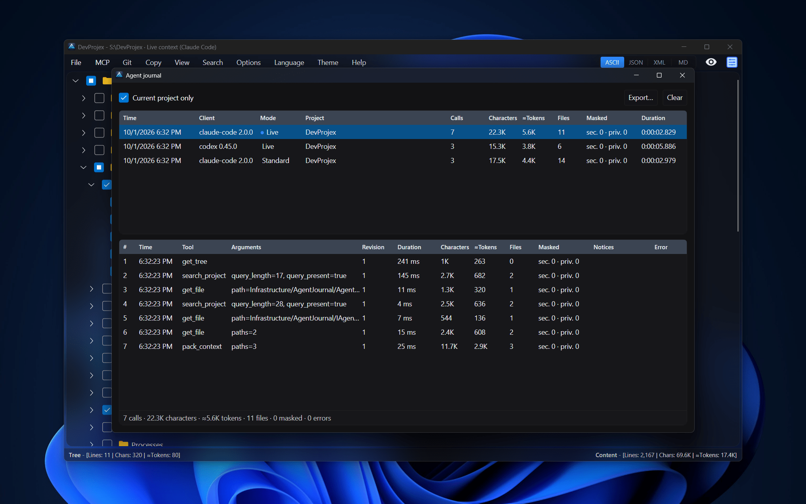
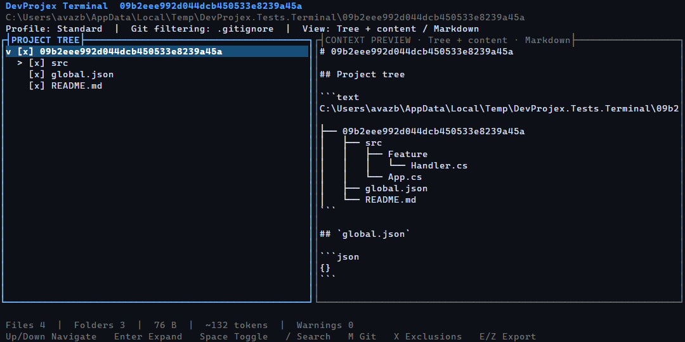

# DevProjex: keep context clean, save tokens, hide secrets

**Smart codebase context for Claude Code, Codex, and Cursor over MCP.**

**A Repomix alternative with up to 40% fewer context tokens for AI agents.**

| Up to 40% | 16.5% | 78 of 84 | 27% |
|:---:|:---:|:---:|:---:|
| fewer context tokens than Repomix | fewer tokens than Claude Code's own file tools | required files found, against 66 with Repomix | fewer tool calls than the built-in tools |

[See the head-to-head benchmarks →](#devprojex-vs-repomix-the-numbers)

[](https://github.com/Avazbek22/DevProjex/releases) [](https://www.npmjs.com/package/devprojex) [](https://www.nuget.org/packages/devprojex) [](https://github.com/Avazbek22/DevProjex/actions) [](LICENSE)  [](https://glama.ai/mcp/servers/Avazbek22/DevProjex) 

* 🎯 **The right code in fewer calls.** Search hits name their function or class, and `related_files` follows real imports.
* 🧹 **No junk in the context window.** Smart Ignore drops `node_modules`, build output, and caches before the agent sees them.
* 🔑 **Secret masking that stays on.** Keys and tokens are masked in every response, and the agent can't switch it off.
* 👀 **Live Context: checkboxes steer the agent.** Tick files in the desktop app, and the agent follows on its next call.
* 🧾 **A receipt for every session.** The agent journal shows what each session received: calls, files, tokens, and masked values.
* ⚡ **Codebase RAG without the vector database.** No embeddings to build, nothing to host, one command to connect.

Connect Claude Code with one line. The agent keeps editing files with its own tools:

```bash
claude mcp add devprojex -- npx -y devprojex mcp --root /absolute/path/to/project
```

Codex, Cursor, VS Code, and other clients: [Connect a client](#connect-a-client).

**Not using an agent?** DevProjex is also a desktop app, a Terminal Workspace, and a CLI on the same engine, for Windows, macOS, and Linux. Tick files in a tree, watch the live preview and its token estimate, and paste clean context into ChatGPT or Claude. Export it as **ASCII, Markdown, JSON, or XML**, or as a project copy in a **folder or ZIP**.

> 🔒 **Local and telemetry-free by design.** DevProjex only reads your project: it does not upload its contents or collect telemetry.

## App demo 🖼️

**🏆 Selected by the Avalonia UI team for the [App Showcase](https://avaloniaui.net/showcase)**



## Download 🚀

**Microsoft Store:**
👉 [DevProjex](https://apps.microsoft.com/detail/9ndq3nq5m354)

**Latest GitHub release (Windows, macOS, Linux):**
👉 [github.com/Avazbek22/DevProjex/releases/latest](https://github.com/Avazbek22/DevProjex/releases/latest)

**WinGet (Windows):** `winget install OlimoffDev.DevProjex`

### Run without installing

The CLI, the Terminal Workspace, and the MCP server run straight from [npm](https://www.npmjs.com/package/devprojex) or [NuGet](https://www.nuget.org/packages/devprojex), or from a direct release binary:

```shell
npx devprojex tree .    # Node.js 20+
dnx devprojex tree .    # .NET SDK 10
./DevProjex tree .      # release binary (DevProjex.exe on Windows)
```

The npm and NuGet packages contain the CLI, the Terminal Workspace, and the MCP server, but not the desktop app. Requirements per platform, the direct headless archives, and the non-root Docker image are all covered in [Docs/Installation.md](Docs/Installation.md).

## Why DevProjex? 💡

A coding agent with plain file access **reads `.env` as easily as `Program.cs`**. It also **pays for every wrong turn in tokens**: each search and each full file goes into the context window. Packing tools give it the whole repository at once, and you **see the result only after it's packed**. Copying files into a chat by hand **doesn't scale**.

DevProjex sits between your code and the model, and gives the agent better ways to read:

* **Search that understands code.** Every match shows the declaration it sits in, so the agent knows where it is.
* **A dependency graph without setup.** `related_files` shows what a file uses and what uses it, from real imports.
* **Big files in small parts.** A large file comes as an outline first, and the agent reads only the part it needs.
* **Changes instead of whole files.** `get_diff` shows staged files, current changes, or the difference between two refs.

### Use it for

* **AI agents:** Claude Code, Codex, Cursor, or any MCP client searches and reads your project through a server that always masks secrets, and you set its focus with checkboxes.
* **Large codebases:** the agent reads the part a task needs instead of the whole repository, and a single module fits into the model's context window.
* **CI pipelines:** fail a build when secrets would leak into packed context, without ever printing the values.
* **AI chats and code to prompt:** clean input for ChatGPT, Claude, DeepSeek, Qwen, or Kimi. It is the job you would give Repomix, gitingest, or code2prompt, with a live preview, a token estimate, and secrets masked in place.
* **Restricted environments:** get the same clean context where AI agents, remote indexing, or IDE plugins are not allowed.
* **Code reviews and teaching:** share the structure and only the files that matter.

## Feature overview ✨

**AI agents**
* **[MCP server](#mcp-server-):** six tools by default and all nine with `--tool-set full`, for any MCP client.
* **[Live Context](#live-context-your-checkboxes-become-the-agents-focus):** tick files in the desktop app and the agent works with that selection on its very next call.
* **Code search:** text, regular expressions, or declarations by name, across the whole selection.
* **Dependency graph:** what a file uses and what uses it, from real imports and type references.
* **Git diff review:** staged files, current changes, or a ref-to-ref diff, with secrets masked in both versions.
* **[Agent journal](#agent-journal-a-receipt-for-every-session):** a record of every session with calls, delivered paths, tokens, and masked values, never file contents.
* **[Security boundaries](#security-boundaries-️):** the server stays inside the folders you allow, marks returned file contents as untrusted data, and lets the agent only narrow what it sees.

**Choose and control**
* **[Smart Ignore](#how-smart-ignore-works-):** hides build output, dependency folders, and caches, but only where it finds real signs of them.
* **[Hide Secrets](#how-hide-secrets-and-hide-private-data-work-):** masks detected credentials in place, in every export and every MCP response.
* **[Hide private data](#how-hide-secrets-and-hide-private-data-work-):** optional masking of emails, IPs, MAC addresses, phone numbers, and user paths.
* **[Code compression](#how-code-compression-works-️):** keeps signatures, empties function bodies; pure code gets about 3× smaller.
* **[Strip comments and blank lines](#how-code-compression-works-️):** syntax-aware cleanup in 20 language packs; source files untouched.
* File tree with checkboxes, search, and name filters.
* **[Git modes](#how-smart-ignore-works-):** `.gitignore`, tracked files, staged files, all current changes, or a ref-to-ref diff.

**Preview and export**
* Live preview (tree, content, or both) with live counters for lines, characters, and a token estimate.
* Export as ASCII, Markdown, JSON, or XML, to a file or the clipboard, tree only, content only, or both.
* Export a [clean copy of your project](#project-copy-export) to a folder or ZIP archive.

**Workflow and interface**
* Desktop app, Terminal Workspace, CLI, and MCP server: the same engine, four ways to work.
* Git tools built in: clone by URL, switch branches, update cached copies.
* Local profiles remember your settings per project.
* Interface in 20 languages, with light, dark, and system themes.

### Project copy export

Use **File → Export project → To folder…** or **To ZIP archive…** to create a separate copy of your current selection. The same workflow is available through `devprojex export project`.

Project copies respect your chosen root folders, file types, ignore rules, and checked items; if nothing is checked, the whole current tree is exported. Directory structure, binary files, and included empty folders are preserved. When **Hide Secrets** or **Hide private data** is enabled, detected values in text files are replaced, binary files remain unchanged, and the result is intentionally not a byte-for-byte copy, so it may not build or run. The source project is never modified, and the result can't be written inside it.

## MCP server 🤖

DevProjex ships a built-in **secure [Model Context Protocol](https://modelcontextprotocol.io) server**, on the official [C# MCP SDK](https://github.com/modelcontextprotocol/csharp-sdk). It turns any local folder or Git repository into token-efficient codebase context for AI agents: **Claude Code, Codex, Claude Desktop, Cursor, Google Antigravity, VS Code, or any MCP client**.

The agent finds what a task needs through code search, the dependency graph, and Git diffs, and keeps editing files with its own tools. It works as codebase RAG with nothing to set up: everything is computed locally from your source files, with no embeddings to build and no vector database to host.

One line connects Claude Code, with or without the desktop app installed:

```bash
claude mcp add devprojex -- npx -y devprojex mcp --root /absolute/path/to/project
```

### Connect a client

* **Desktop app:** **MCP → Live context** or **MCP → Standard**, then **Open in Claude Code**, Codex, Cursor, or VS Code. The submenu you pick decides whether the agent follows the files you tick.
* **Terminal Workspace:** `mcp connect <client> [live|standard]` registers the server without opening another terminal; live mode is the default here.
* **CLI:** `devprojex mcp connect . --client <client>` (standard mode unless `--mode live` is given). Add `--open` to launch the client, or `--print` when only a manual configuration fragment is needed.
* **Without the desktop app:** the npm or NuGet package runs the same server through `npx -y devprojex` or `dnx devprojex`. Snippets for every client are in [Docs/McpServer.md](Docs/McpServer.md#client-configuration).

For Cursor and VS Code, DevProjex writes `.cursor/mcp.json` or `.vscode/mcp.json` in the project and leaves other servers in those files alone.

To check the connection, run `/mcp` in Claude Code or `codex mcp list`, then ask: “Through DevProjex, show the tree of the current selection.” The call appears in the agent journal.

### Live Context: your checkboxes become the agent's focus



Open the project in the desktop app and connect through **MCP → Live context**. From then on, the agent works with the files you tick:

* **Changes apply at once.** Tick or untick a file, and the agent sees the new selection on its next call. No restart and no new prompt.
* **The ticks set the focus.** Tree, search, analysis, dependency, and pack operations stay inside the ticked files. The agent can still read a file outside them by name, and it gets an outside-focus notice.
* **Your filters are the limit.** The desktop app's filters and secret masking apply to everything the agent reads, and files your filters exclude stay out of reach.
* **You see what the agent took.** Every file the agent received is marked in the tree with a count.

Live context uses `--live`; **Standard** connects the same server but does not follow the window selection.

### 6 tools by default, 9 with the full set

Nine tools cover the whole workflow, and none of them can change a file: `list_projects`, `get_tree`, `analyze`, `search_project`, `related_files`, `get_file`, `get_diff`, `pack_context`, and `read_pack`.

By default the server publishes the six tools an agent uses in everyday work: `get_tree`, `search_project`, `get_file`, `related_files`, `get_diff`, and `read_pack`. A shorter tool list costs the model fewer tokens on every request. Start the server with `--tool-set full` to publish `analyze` and `pack_context` as well.

* `search_project` finds text or declarations by name. `get_file` reads an exact line range, one declaration, or up to sixteen files in one call. For a large file the agent gets its beginning and an outline with line ranges, so it reads only the part it needs.
* `related_files` shows what a file uses and what uses it, based on real imports. It works for one file, several files, or the files in a folder, and following these links never widens the selection.
* `get_diff` shows a change as unified hunks: staged files, current changes, or a ref-to-ref diff. The largest changes come first, secrets are masked in both versions, and the agent reads only the lines that changed.
* `pack_context` packs a selection within `max_tokens`. Files are added in a fixed order while they fit, the rest are reported as skipped, and `top_files` shows where the tokens go.
* When a result of `pack_context` or `related_files` is too large, the server stores it as a session pack, and `read_pack` reads it back in line ranges.
* Trees come as compact Markdown, file content names the root once and uses relative paths, and every tree ends with a line that names the active filters, so the agent knows what it did not see.
* `git_scope` narrows a call to staged files, current changes, or a ref-to-ref diff. `profile` switches between built-in defaults, your saved desktop selections, and a portable profile file. The default set publishes `git_scope` only on `get_diff` and does not publish `profile`; both are still accepted where a tool takes them, and `--tool-set full` publishes every parameter.

### Agent journal: a receipt for every session



The **agent journal** is stored on your machine. It records metadata and counts for MCP sessions, never file contents or detected secret values.

Each session shows the client, the mode, and its totals: calls, characters, token estimate, delivered files, masked values, and duration. Open a session to see every tool call with a summary of its arguments, its revision, timing, and notices.

Read the journal in the desktop app (**MCP → Journal**), the Terminal Workspace, or the CLI. You can export a session as a Markdown or JSON **context receipt** with calls, delivered paths, and totals.

### Security boundaries 🛡️

The MCP server enforces these boundaries:

* **Read-only by design.** Tools cannot change project files or run project code. Network access is off unless you turn on `--allow-remote` for Git URL projects.
* **Secret masking is always on and has no off switch.** There is no server flag for it and no tool parameter, so neither a configuration mistake nor the agent can turn it off.
* **Optional private-data masking** via `devprojex mcp --hide-private-data`, mirroring the CLI flag.
* **Root jail.** The server reads only inside the root folders it was started with. A remote Git URL checkout, if you allow it, is pinned on first use. Symlinks and junctions that lead outside are rejected.
* **The agent can only narrow the view.** Paths and globs from the agent can only narrow the selection, and the `.git` folder itself is never exposed.
* **Git's view by default.** Smart Ignore and `.gitignore` apply, while `Dockerfile`, `.github/`, dot-files, and empty files stay visible. Only you can widen that view, and only at startup: with an `--exclude` baseline, the `--unrestricted` preset, or the opt-in `--allow-agent-exclusions` flag.
* **Prompt-injection protection.** File contents are returned inside untrusted-data markers.

Masking cannot be turned off, but no detector finds every secret. DevProjex detects common secret formats, so review each pack before you publish it outside your environment.

See [Docs/McpServer.md](Docs/McpServer.md) for client setup, the full tool reference, and the security model.

### DevProjex vs Repomix: the numbers

In two blind benchmark runs, agents used **40.9% and 28.8% fewer context tokens** with DevProjex than with Repomix. Each run has 18 tasks, the same model on every side, and a judge who sees only `Answer A` and `Answer B`.

The second run also measured Claude Code's own file tools:

| | DevProjex | Repomix | Claude Code's own tools |
|---|:---:|:---:|:---:|
| Context tokens | **8.9M** | 12.5M | 10.6M |
| Required files found, of 84 | **78** | 66 | 64 |
| Tool calls | **331** | 374 | 454 |
| Sessions that ran out of turns | **0** | **0** | 2 |
| Cost of 18 sessions | **$2.41** | $3.34 | $2.67 |

*12 November 2026: DevProjex `1f90ac4b`, Repomix 1.19.0, Claude Haiku 4.5 in Claude Code.*

The blind judge preferred DevProjex's answer in **15 of 18 tasks** against Repomix.

**What if the agent just reads the project itself?** That is the third column: Claude Code's own `Read`, `Grep`, and `Glob`, with no MCP server. With DevProjex the agent used 16.5% fewer tokens and 27% fewer tool calls, and found 14 more of the required files.

In a separate test with seven planted credentials, neither tool leaked one. Repomix drops a file when it finds a secret in it; DevProjex masks the value and keeps the code around it, so all seven files stayed readable, against one with Repomix. Repomix is the better choice for broad "how does X work" questions, where packing once and searching the pack is cheaper.

The full tables are published. The November runs are in [Docs/Benchmarks](Docs/Benchmarks/README.md). The September series (11 tasks in six languages), with the agents' and the judge's verdicts word for word, is in [Docs/Benchmark-History.md](Docs/Benchmark-History.md).

## Command line ⚙️

DevProjex also runs in the terminal: a keyboard-first **Terminal Workspace** for interactive work, and a CLI for scripts, project analysis, and context export.



```bash
devprojex                                                      # open the Terminal Workspace
devprojex open . --preview                                     # desktop app on this folder, preview pane open
devprojex tree .                                               # project tree
devprojex tree https://github.com/owner/repo --branch main     # tree of a remote repository
devprojex analyze . --format json                              # files, lines, tokens, largest files
devprojex analyze . --git-mode tracked --exclude smart-ignore  # tracked files only, with Smart Ignore applied
devprojex analyze . --hide-secrets --findings --fail-on-findings   # CI gate: findings, never values
devprojex export context . --format markdown -o ../context.md  # packed context for a chat
devprojex export context https://github.com/owner/repo -o -    # straight from a Git URL to stdout
git diff --name-only | devprojex export context . --select-from - -o -   # only the changed files
devprojex export project . --as zip --hide-secrets -o ../submission.zip   # masked project copy
devprojex search Configure . --symbols                         # declarations by name
devprojex related src/App.cs --direction both                  # what a file uses, and who uses it
devprojex profile save . --hide-secrets on                     # remember these settings for this project
devprojex cache update https://github.com/owner/repo           # refresh a cached clone
```

### What the CLI adds

* **Scriptable exports for CI pipelines:** JSON reports, stdout output, deterministic files.
* **Git repository URLs as project sources:** analyze, export, open, or start the Terminal Workspace on a repository straight from its URL through a managed clone cache (`devprojex cache`, `devprojex recent`).
* **A secret check for CI:** `--findings` lists rule, category, file, and line, never the values, and `--fail-on-findings` fails the pipeline when findings exist.
* **Selection from a pipe:** send a file list from `git diff` or any other tool into `--select-from -`.
* **Project search and relations:** `devprojex search` finds text, `--regex` patterns, or declarations by name with `--symbols`; `devprojex related` lists the files a file uses and the files that use it.
* **Documented aliases and short flags** (`export ctx`, `export proj`, `-f`, `-n`, `-q`), plus `devprojex help <command>` and shell completion for bash, zsh, fish, and PowerShell.
* **A keyboard-first Terminal Workspace** with a searchable Action Palette, no desktop app needed, and the same Git modes, exclusions, and profiles as the desktop app.

See [Docs/CommandLine.md](Docs/CommandLine.md) for the full command reference, and [Docs/TerminalWorkspace.md](Docs/TerminalWorkspace.md) for the interactive terminal interface.

## What DevProjex never does 🛡️

DevProjex only reads your project. The one exception is an explicit Cursor or VS Code MCP connection, which creates or updates `.cursor/mcp.json` or `.vscode/mcp.json`. Beyond that, DevProjex:

* Does not edit, rename, move, or delete files in the opened source project.
* Does not commit, merge, push, or switch branches in a repository opened from your disk; branch operations happen only in cached clones that DevProjex owns.
* Does not include binary file contents in text or AI-context output; masking rules do not scan binary data.
* Writes generated files and project copies only to destinations you choose, outside the source project.

## How Smart Ignore works 🧠

Smart Ignore is a local, deterministic filter. It does not use an AI model, and it is not one big blacklist for the whole folder. It finds where each project starts and ends, and applies the right rules only inside that project.

**It knows project boundaries.** DevProjex finds project markers like `.csproj`, `package.json`, `pyproject.toml`, `go.mod`, or `Cargo.toml`. Rules for that stack (`node_modules`, `bin`/`obj`, virtual environments, build caches) apply only inside the project that owns them. A .NET service won't hide `bin` in an unrelated folder next to it, and a frontend app won't hide `node_modules` somewhere it doesn't belong.

**It checks before it hides anything.** Folder names like `build`, `dist`, or `vendor` can mean generated files or real source code. Smart Ignore looks for real signs first: package files, compiler output, known build layouts. If there's no clear sign, the folder stays visible.

**It keeps monorepos separate.** Each nested project (frontend, backend, tools, docs) is filtered on its own, based on its own markers. Nothing crosses over between unrelated parts of your workspace.

**Git modes are a separate setting, not part of Smart Ignore:**

| Mode | What it shows |
|---|---|
| `.gitignore` mode | Tracked files plus untracked files that repository-local `.gitignore` and `info/exclude` allow, following `git status`; embedded repositories stay opaque and declared submodules keep their own rules |
| Tracked-files-only | Only files currently recorded in the Git index |
| Staged | Files with staged changes |
| Changes | Staged, unstaged, and non-ignored untracked files |
| Diff | Files changed between two Git references |

**You stay in control.** Smart Ignore, the Git mode, and basic filters (hidden files, dot-files, empty folders) all work together and can be turned on or off one by one. "Ignored" means excluded from the current view, copy, or export; it never deletes anything from your project.

📖 Full technical details, including signature matching, worktree handling, and edge cases, are in [`Docs/SmartIgnore.md`](Docs/SmartIgnore.md).

## How code compression works 🗜️

An AI rarely needs every implementation line; it needs the shape of your code. Compression keeps declarations, signatures, fields, and class structure, and empties named implementation bodies:

```csharp
// Before: what's in your file (unchanged on disk)
private Command BuildMcpCommand()
{
    var command = new Command("mcp", L("Terminal.Command.Mcp"));
    // … ~40 more lines of implementation
}

// After: what goes into the packed context
private Command BuildMcpCommand()
{ }
```

Measured on DevProjex's own C# sources (619 files), the packed context shrinks by about 69%, roughly 3× smaller. Compression touches only code and leaves test fixtures, JSON assets, and documentation as they are.

Compression covers 14 languages. It parses code with [Tree-sitter](https://tree-sitter.github.io/tree-sitter/) grammars and applies DevProjex's own rules for each language about what must stay. It is careful by design: a file it can't process safely stays complete.

Comment and blank-line stripping uses the same syntax engine and covers 20 packs in total: the 14 languages plus six comments-only packs such as HTML, CSS, YAML, and XML project files. The same transformed content goes into token metrics, context documents, and folder or ZIP exports, in the desktop app and with `--compress-code` in the CLI.

📖 Per-language rules and edge cases are in [`Docs/CodeCompression.md`](Docs/CodeCompression.md).

## How Hide Secrets and Hide private data work 🔒

Two independent layers. Both replace values inside the output; they never delete a file and never modify your project.

**Hide Secrets** finds credential values (API keys, tokens, connection strings) and masks each one where it stands, keeping the file and all surrounding code:

```text
var botToken = "110201543:AAHdqTcvE…";                          // in your file
var botToken = "DEVPROJEX_REDACTED[telegram-bot-api-token#1]";  // in the export
```

Detection uses a reviewed [Gitleaks](https://github.com/gitleaks/gitleaks) rule set with a fixed version, running on DevProjex's own engine. You can exclude a false positive match by match right in the preview. Turn it on with one switch in the desktop app or with `--hide-secrets` in the CLI; in the MCP server it is always on, see [Security boundaries](#security-boundaries-️). In CI, `--fail-on-findings` fails the build without printing any value.

**Hide private data** is the second, optional layer, for personal data: emails, global IPs, local-user paths, MAC addresses, and international phone numbers. They become `DEVPROJEX_REDACTED[email#1]`, `[ipv4#1]`, `[local-user#1]`, and so on. The same value gets the same placeholder in every interface, so exported code stays consistent.

It is off by default, because real projects are full of version strings that look like IPs and sample emails that are not personal. Turn it on per profile in the desktop app, or with `--hide-private-data` in the CLI and the MCP server.

📖 Detection rules and edge cases: [`Docs/HideSecrets.md`](Docs/HideSecrets.md) · [`Docs/HidePrivateData.md`](Docs/HidePrivateData.md)

## Documentation 📚

[Installation](Docs/Installation.md) · [Smart Ignore](Docs/SmartIgnore.md) · [Hide Secrets](Docs/HideSecrets.md) · [Hide private data](Docs/HidePrivateData.md) · [Code Compression](Docs/CodeCompression.md) · [Command Line](Docs/CommandLine.md) · [Terminal Workspace](Docs/TerminalWorkspace.md) · [MCP Server](Docs/McpServer.md) · [Agent Journal](Docs/AgentJournal.md) · [Related files](Docs/Dependencies.md) · [Benchmark History](Docs/Benchmark-History.md) · [Security policy](SECURITY.md) · [Contributing](CONTRIBUTING.md) · [Code of Conduct](CODE_OF_CONDUCT.md) · [Discussions](https://github.com/Avazbek22/DevProjex/discussions)

## Tech stack 🧩

Built with **.NET 10** and **Avalonia UI**, with **Tree-sitter** grammars, **Gitleaks** rules, and the official **MCP** C# SDK; attributions in [THIRD-PARTY-NOTICES.md](THIRD-PARTY-NOTICES.md). 20,000+ automated tests (unit, integration, terminal, UI) run on Windows, Linux, and macOS.

**Build from source**

```bash
git clone https://github.com/Avazbek22/DevProjex.git
cd DevProjex
dotnet build -c Release
dotnet test
```

## Contributing 🤝

Issues and pull requests are welcome. Good places to start: **UX**, **performance tuning**, **tests**, **localization**, **documentation and screenshots**. Not sure where? Check issues labeled [`good first issue`](https://github.com/Avazbek22/DevProjex/labels/good%20first%20issue).

See [CONTRIBUTING.md](CONTRIBUTING.md) for details.

## Support 💛

[](https://boosty.to/avazbek22)

## License (Apache-2.0) 📄

DevProjex is licensed under the **Apache License 2.0**: free to use, modify, and distribute, with an explicit patent grant. Copyright (c) 2025–present Avazbek Olimov. See [LICENSE](LICENSE) for details.
